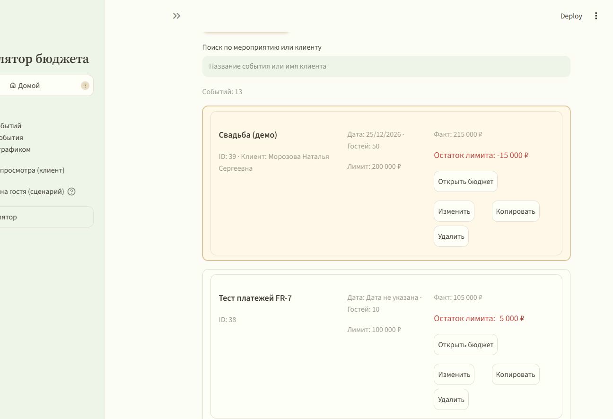
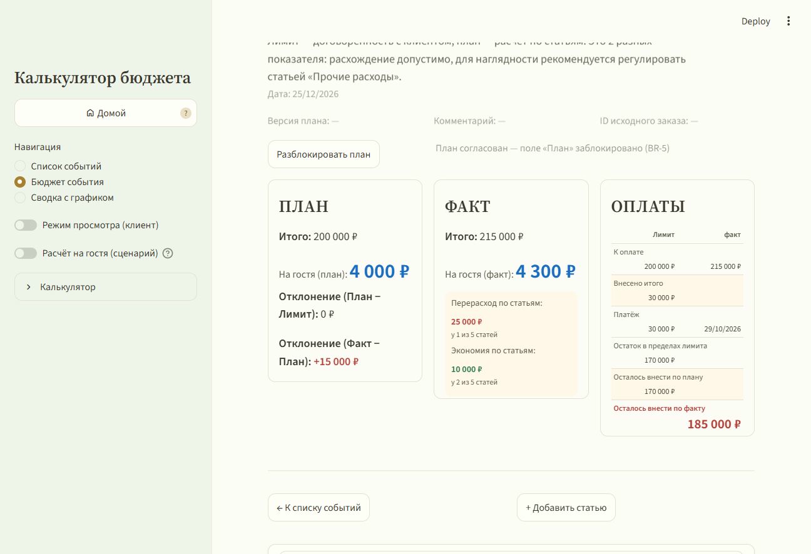
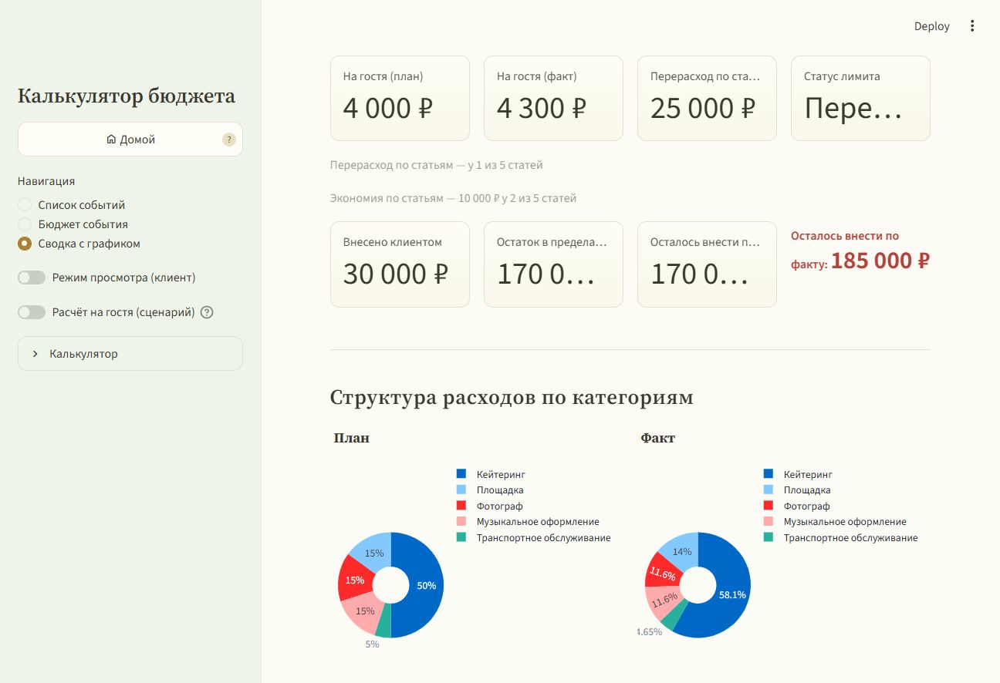
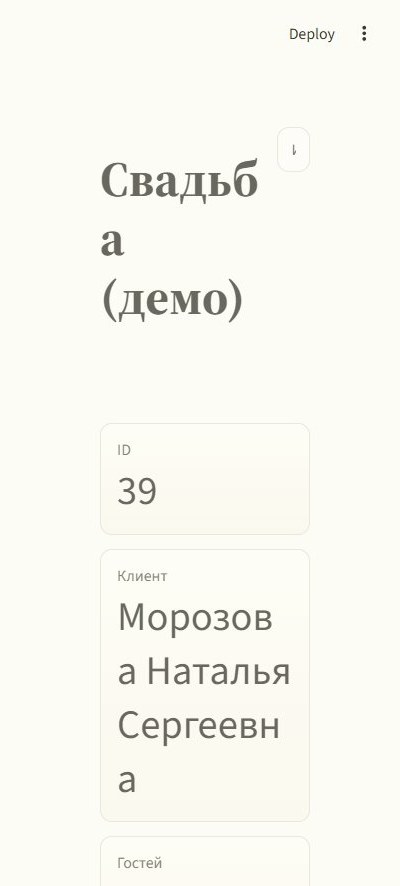
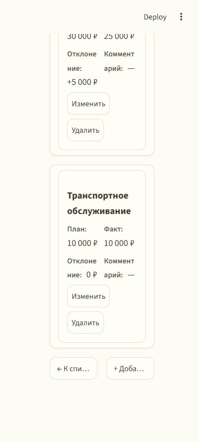

# Калькулятор бюджета события

**Event Budget Calculator** — локальное веб-приложение для организатора мероприятий:
бюджет события раскладывается по статьям, план и факт сравниваются в одном экране,
а перерасход виден сразу — до того, как деньги потрачены.

[](https://github.com/loparenok01-cpu/event-budget-calculator/actions/workflows/tests.yml)


> Учебный MVP: требования → архитектура → реализация → автотесты → CI.
> Полный кейс — в [`docs/case/Kejs_praktika.md`](docs/case/Kejs_praktika.md),
> интерактивная версия — в [`docs/case/Kejs_praktika.html`](docs/case/Kejs_praktika.html).

---

## Скриншоты

| Список событий | Бюджет события |
|---|---|
|  |  |

**Сводка с графиком** — итоги, остатки лимита и структура расходов по категориям:



Приложение адаптировано под телефон: шапка метрик и таблица статей складываются
в карточки, горизонтальная прокрутка не нужна.

| Мобильный список | Мобильная таблица статей |
|---|---|
|  |  |

---

## О проекте

### Проблема

Организатор планирует мероприятие с фиксированным лимитом: площадка, кейтеринг,
декор, ведущий и другие расходы. Плановые суммы известны заранее, фактические
оплаты появляются по ходу подготовки. Если план и факт живут в разных таблицах,
заметках и переписке, перерасход обнаруживается постфактум — когда деньги уже
потрачены.

### Решение

Одно локальное приложение, в котором:

- бюджет события собран по статьям расходов;
- по каждой статье рядом стоят **план** и **факт**;
- перерасход подсвечивается по статье и по общему лимиту;
- клиент получает безопасный режим просмотра и отчёт CSV;
- данные не уходят в облако и хранятся в одном файле SQLite.

### Для кого

| Роль | Что делает |
|---|---|
| **Организатор** | Создаёт события, ведёт статьи и платежи, согласует план, следит за лимитом |
| **Клиент** | Смотрит бюджет в режиме просмотра и получает отчёт CSV; вход и пароли не нужны |

---

## Возможности

| Блок | Что умеет |
|---|---|
| **События** | Создание, редактирование, копирование, удаление; клиент, дата, гости, лимит; поиск по мероприятию и клиенту; версия плана и ID исходного заказа |
| **Статьи бюджета** | Категория, план, факт, комментарий; базовые категории и свои через «Другое»; тарификация на человека (₽/чел) |
| **План и факт** | План может быть пустым («не внесено»), факт обязателен; отклонения по каждой статье; перерасход и экономия |
| **Лимит** | Остаток по плану и по факту; стоимость на гостя; отдельная метрика «Отклонение (Факт − Лимит)» |
| **Оплаты** | Платежи «дата + сумма» до 10 строк; внесено, остаток в пределах лимита, осталось внести по плану и по факту |
| **Согласование плана** | После «Согласовать план» плановые суммы защищены от случайной правки; факт продолжает вноситься |
| **Сценарий «Расчёт на гостя»** | «Что если будет N гостей»: переменные статьи считаются по тарифу, фиксированные берутся из бюджета; данные события не меняются |
| **Режим просмотра** | Скрывает редактирование, оставляет данные, подсветку и графики — для показа клиенту |
| **Отчёт CSV** | Шапка события, статьи, итоги и блок оплат; открывается в Excel (UTF-8, разделитель `;`) |
| **Калькулятор** | Встроенный, доступен на всех экранах; кнопки и командная строка |

---

## Демо-сценарий

В кейсе разбирается свадьба на 50 гостей:

- лимит — 200 000 ₽;
- план — 200 000 ₽, факт — 215 000 ₽;
- кейтеринг: план 100 000 ₽, факт 125 000 ₽ → строка подсвечена, «Перерасход»;
- стоимость на гостя выросла с 4 000 ₽ до 4 300 ₽;
- «Отклонение (Факт − Лимит)» = +15 000 ₽ — приложение сразу показывает выход за лимит.

Подробнее: [`docs/case/Kejs_praktika.md`](docs/case/Kejs_praktika.md).

---

## Архитектура

```
┌──────────────────────────────────────────────┐
│ app.py — интерфейс Streamlit                 │
│ экраны, формы, CSS, навигация                │
└───────────────┬──────────────────────────────┘
                │ вызывает только функции
      ┌─────────┴──────────┐
      ▼                    ▼
┌──────────────┐   ┌───────────────────────────┐
│ calc.py      │   │ db.py                     │
│ расчёты      │   │ SQLite: события, статьи,  │
│ без Streamlit│   │ категории, платежи        │
└──────────────┘   └───────────────────────────┘
```

Принципы, которые заложены в проект:

- **Расчёты отделены от интерфейса.** `calc.py` — чистые функции без Streamlit;
  их можно тестировать отдельно и переиспользовать.
- **Единый источник данных.** Сводка, таблица и график строятся из одного
  агрегированного результата, поэтому не расходятся между собой.
- **Пустой план ≠ ноль.** NULL («не внесено») не превращается в 0 и не создаёт
  ложную экономию; факт обязателен по каждой статье.
- **Данные локальны.** Никаких внешних API, CDN, шрифтов и телеметрии:
  только Python, SQLite и браузер.

---

## Стек

| Слой | Технология |
|---|---|
| Язык | Python 3.10–3.14 |
| Интерфейс | Streamlit |
| Таблицы и агрегация | Pandas |
| Графики | Plotly |
| Хранилище | SQLite (`sqlite3` из стандартной библиотеки) |
| Тесты | pytest, 64 теста |
| CI | GitHub Actions |

---

## Быстрый старт

### Windows

```bat
git clone https://github.com/loparenok01-cpu/event-budget-calculator.git
cd event-budget-calculator

python -m venv .venv
.venv\Scripts\activate
python -m pip install --upgrade pip
python -m pip install -r requirements.txt
```

### Linux / macOS

```bash
git clone https://github.com/loparenok01-cpu/event-budget-calculator.git
cd event-budget-calculator

python3 -m venv .venv
source .venv/bin/activate
python -m pip install --upgrade pip
python -m pip install -r requirements.txt
```

### Запуск

```bash
streamlit run app.py
```

Приложение откроется на **http://localhost:8501**.

Демонстрационное событие (по желанию):

```bash
python seed_demo.py
```

База `database.db` создаётся автоматически при первом запуске. Если порт 8501
занят:

```bash
streamlit run app.py --server.port 8511
```

Остановка — `Ctrl + C`. Подробная инструкция по установке, резервному
копированию и типовым ошибкам — в [`docs/TZ.md`](docs/TZ.md) и
[`docs/Pasport_proekta.md`](docs/Pasport_proekta.md).

---

## Тесты

```bash
pytest
```

Ожидаемый результат:

```
64 passed
```

Покрыты: итоги плана и факта, пустой план, обязательный факт, нулевой факт,
0 гостей, стоимость на гостя, остатки лимита, перерасход и экономия по статьям,
«Статья без плана», оплаты с переплатой, согласованный пересчёт лимита,
пересчёт факта переменных статей, сценарий «Расчёт на гостя», калькулятор
(командная строка, «=» необязателен, деление на 0), структура CSV и формат даты.

CI-пайплайн запускает те же тесты на каждый push и pull request:
[`.github/workflows/tests.yml`](.github/workflows/tests.yml).

---

## Структура проекта

```
event-budget-calculator/
├── app.py                       # интерфейс Streamlit
├── calc.py                      # чистые функции расчётов
├── db.py                        # SQLite: схема, CRUD, копирование события
├── seed_demo.py                 # демонстрационное событие
├── requirements.txt             # streamlit, pandas, plotly, pytest
├── .env.example                 # необязательные переменные окружения
├── .streamlit/
│   └── config.toml              # тема оформления
├── tests/
│   └── test_calc.py             # 64 автотеста расчётов
├── docs/
│   ├── TZ.md                    # техническое задание
│   ├── Pasport_proekta.md       # паспорт проекта: границы, риски, этапы
│   ├── case/
│   │   ├── Kejs_praktika.md     # кейс практики
│   │   └── Kejs_praktika.html   # самодостаточная кейс-страница
│   └── screenshots/             # скриншоты интерфейса
├── .github/
│   └── workflows/
│       └── tests.yml            # CI: pytest
└── README.md
```

Файлы базы данных, виртуальное окружение, кэш и локальные настройки
исключены через `.gitignore`.

---

## Бизнес-правила

| Правило | Формулировка |
|---|---|
| **BR-1. Категории** | Базовые: Площадка, Кейтеринг, Декор, Ведущий. Своя категория вводится через «Другое» и сохраняется в справочник |
| **BR-2. На гостя** | Стоимость на гостя = итог ÷ число гостей, округление до 0,01 ₽; при 0 гостей — «—». Изменение гостей не меняет лимит и планы автоматически |
| **BR-3. Перерасход** | По статье: план внесён и факт > план. По событию: суммарный факт > лимит. Оба случая подсвечиваются |
| **BR-4. План и факт** | План может быть пустым (NULL, «не внесено»). Факт обязателен (≥ 0), 0 — явный ноль |
| **BR-5. Согласование** | После «Согласовать план» плановые суммы блокируются; разблокировка — только с подтверждением |
| **BR-6. Даты** | В интерфейсе и CSV — `дд/мм/гггг`; в SQLite — ISO `ГГГГ-ММ-ДД` |

Полные требования, пользовательские истории и критерии приёмки —
в [`docs/TZ.md`](docs/TZ.md).

---

## Модель данных

SQLite, четыре таблицы:

| Таблица | Назначение | Ключевые поля |
|---|---|---|
| `event` | событие | название, клиент, дата, гости, лимит, режим лимита, комментарий, версия плана, `plan_approved`, `parent_id` |
| `category` | справочник категорий | название, признак базовой категории |
| `article` | статья бюджета | событие, категория, план (NULL допустим), факт, комментарий, `per_person` |
| `payment` | платежи клиента | событие, сумма, дата |

Ограничения целостности: `CHECK` на лимит и неотрицательные суммы,
внешние ключи с `ON DELETE CASCADE` для статей и платежей, `SET NULL`
для связи копии с прообразом.

---

## Ограничения MVP

- Один пользователь, локальная работа; авторизации и паролей нет —
  роль «Клиент» включается переключателем «Режим просмотра».
- SQLite-файл не синхронизируется с облаком; резервная копия — вручную.
- Экспорт только в CSV, без PDF.
- Сравнение нескольких вариантов смет одного события не поддерживается.
- Нет календаря, напоминаний и графика платежей по датам.
- Пользовательские категории нельзя удалить или переименовать.
- До 10 платежей на событие.

---

## Что дальше

- сравнение альтернативных смет: несколько площадок, меню и вариантов декора;
- аналитика между событиями и сводные дашборды;
- экспорт PDF и красивая печатная форма отчёта;
- облачное хранение с историей изменений и командной работой;
- авторизация и разграничение прав организатора и клиента.

---

## Документация

- [Техническое задание](docs/TZ.md) — требования, бизнес-правила, модель данных, приёмка.
- [Паспорт проекта](docs/Pasport_proekta.md) — цель, границы MVP, риски, этапы.
- [Кейс практики](docs/case/Kejs_praktika.md) — демо-сценарий, проверка, ограничения.
- [Кейс-страница HTML](docs/case/Kejs_praktika.html) — самодостаточная версия со скриншотами.

---

## Автор

**Елена Лопарева** · [github.com/loparenok01-cpu](https://github.com/loparenok01-cpu)

Проект создан в учебных целях как MVP: от технического задания и паспорта
проекта до работающего приложения, автотестов и CI.
