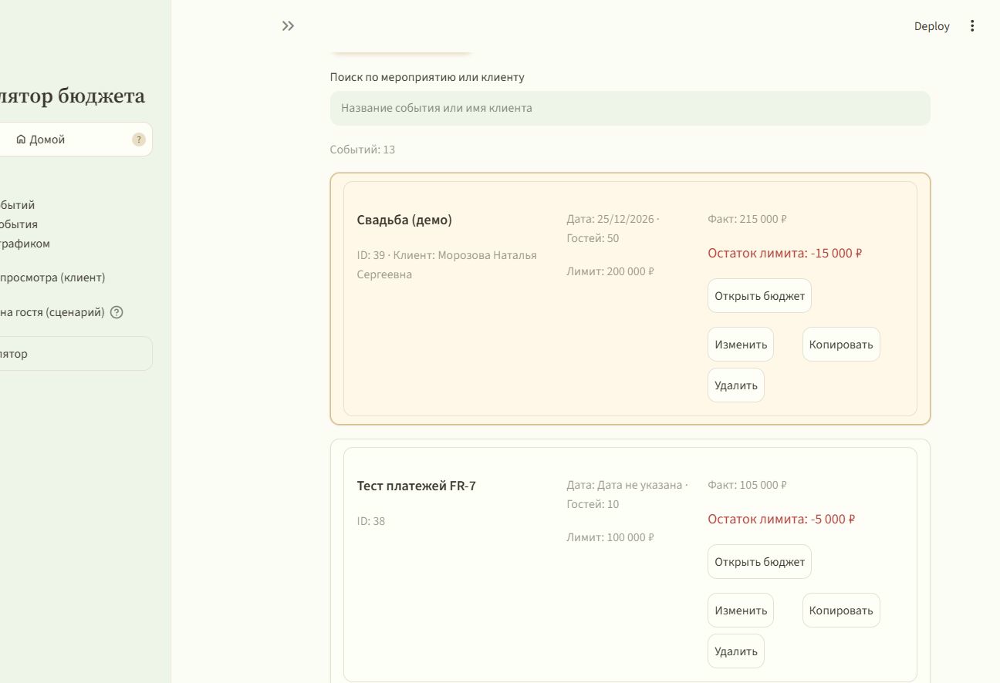
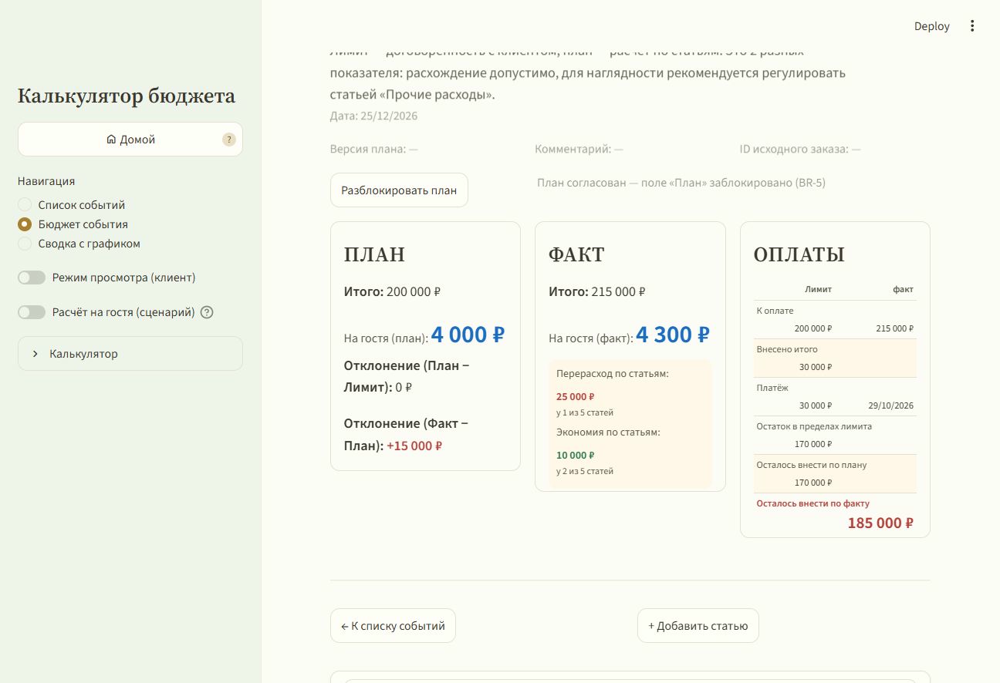
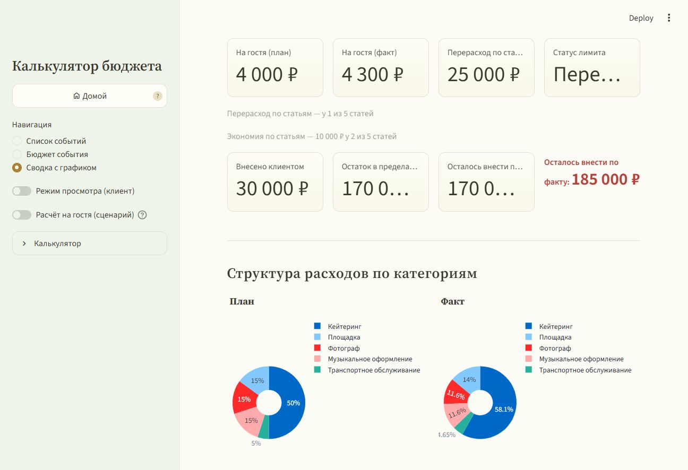

# Кейс: «Калькулятор бюджета события»

Учебная практика · MVP · Python + Streamlit + SQLite

---

## 1. Демо-сценарий: свадьба на 50 гостей

Событие **«Свадьба (демо)»**: 50 гостей, лимит 200 000 ₽, план 200 000 ₽,
факт 215 000 ₽.

**Что показывает сценарий:**

1. Организатор создаёт событие: дата 25/12/2026, 50 гостей, лимит 200 000 ₽.
2. Вносит статьи: Кейтеринг (план 100 000 ₽), Площадка (30 000 ₽), Фотограф
   (30 000 ₽), Музыкальное оформление (30 000 ₽), Транспортное обслуживание
   (10 000 ₽).
3. **Перерасход по кейтерингу:** факт 125 000 ₽ при плане 100 000 ₽ — строка
   подсвечена красным с пометкой «Перерасход», отклонение −25 000 ₽.
4. **Пересчёт стоимости на гостя:** тариф кейтеринга вырос с 2 000 ₽/чел
   (план) до 2 500 ₽/чел (факт); показатели «На гостя (план)» = 4 000 ₽ и
   «На гостя (факт)» = 4 300 ₽ видны в шапке бюджета и в сводке.
5. **Итог:** перерасход по статьям 25 000 ₽ (у 1 из 5 статей), экономия
   10 000 ₽ (у 2 из 5), «Отклонение (Факт − Лимит)» = +15 000 ₽ — приложение
   сразу показывает уход за лимит.

По этому сценарию сняты скриншоты ниже.

## 2. Проблема и пользователь

Организатор событий ведёт бюджет мероприятия по статьям (площадка, кейтеринг,
декор, ведущий) в условиях ограниченного лимита: плановые суммы известны
заранее, фактические оплаты копятся по ходу подготовки, а разрозненные таблицы
и заметки не дают единой картины — перерасход обнаруживается постфактум, когда
деньги уже потрачены. Приложение собирает план и факт в одном месте, показывает
отклонения по каждой статье, стоимость на гостя и остаток лимита сразу при
вводе сумм, а клиент получает безопасный режим просмотра и отчёт CSV.

## 3. Скриншоты

**Главный экран** — список событий с фактом и остатком лимита:

**Ключевое действие** — бюджет события: таблица статей и панели «ПЛАН» /
«ФАКТ» / «ОПЛАТЫ», перерасход по кейтерингу подсвечен:

**Результат** — сводка с графиком структуры расходов и итогами:

**Мобильная версия.** Приложение работает и с телефона: шапка метрик и
таблица статей складываются в карточки (адаптив до 820 px, без горизонтальной
прокрутки).

## 4. Как проверял

**Автотесты** (`pytest`, 64 теста, модуль `calc.py`):
пустой план ≠ 0, обязательный факт, 0 гостей, превышение лимита, «Статья без
плана», перерасход/экономия по статьям, остатки оплат с переплатой, сценарий
«Расчёт на гостя», согласованный пересчёт лимита, пересчёт факта переменных
статей при смене гостей, калькулятор (командная строка, «=» не обязателен,
деление на 0), структура CSV-отчёта, формат даты дд/мм/гггг.

**Ручные тест-кейсы:** главный сценарий на чистой базе; граничные случаи
(лимит 0 — отказ валидации; 0 гостей — «—»; план NULL — «Статья без плана»;
превышение лимита — красный остаток; выбор «Другое» и повторный выбор
сохранённой категории); обязательность факта; совпадение сумм таблицы и
графика; режим просмотра; согласование и разблокировка плана; поиск событий;
калькулятор; экспорт CSV; работа на ширине 390 px.

## 5. Ограничения и вторая версия

**Честно не вошло в MVP:** авторизация и роли (роль «Клиент» — переключатель
«Режим просмотра»); облачная синхронизация и несколько пользователей
(данные — локальный файл SQLite); сравнение нескольких вариантов смет одного
события; экспорт в PDF (только CSV); график платежей по датам, напоминания и
календарь; удаление и переименование пользовательских категорий; сводная
аналитика между событиями; больше 10 платежей на событие.

**Вторая версия:** сравнение альтернативных смет (несколько площадок/меню),
аналитика по событиям, экспорт PDF, облачное хранение с историей правок.

---

Полные требования и правила — в [`TZ.md`](../TZ.md); границы и риски — в
[`Pasport_proekta.md`](../Pasport_proekta.md); установка и запуск — в
[`README.md`](../../README.md).
